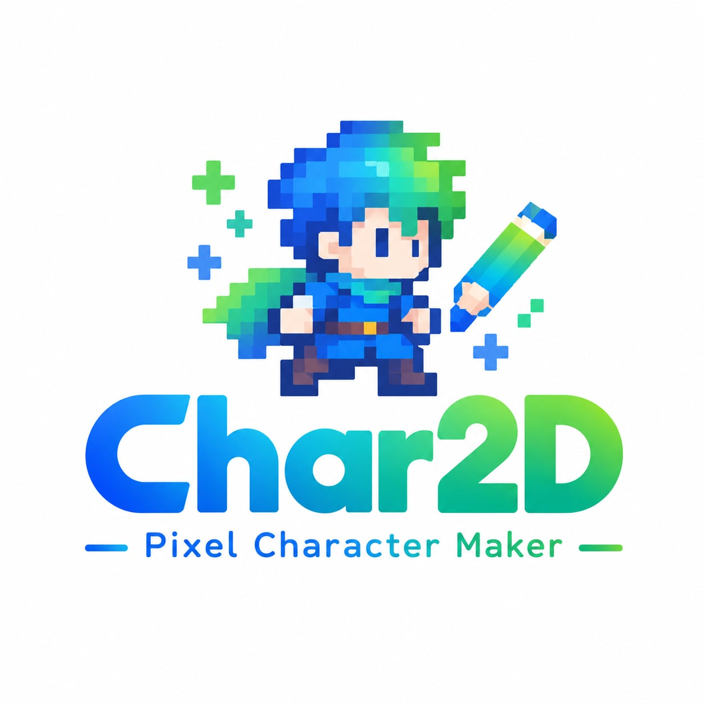

<p align="center">
  
</p>

<h1 align="center">Char2D</h1>

<p align="center"><b>One image in. A playable anime pixel-art character out.</b></p>

---

Char2D turns a single image into an animated pixel-art game character. It generates a character sheet, builds sprite atlases for each action, and lets you add or adjust actions by chatting. You can then map actions to buttons and play your characters in a sample side-scroller or top-down world, all in the browser.

## Features

- **Single image → character**: generates a pixel-art character sheet, then sprite sequences from it
- **Default actions per view type**: side-scroller (left, right, jump, crouch) or top-down (up, down, left, right)
- **Chat to animate**: ask for new actions (attack, dash, …) or tweaks to existing ones
- **Button mapping**: bind keys or gamepad buttons to any action
- **Playground**: control one or more characters in sample worlds

## Tech stack

Next.js · React · TypeScript · SQLite · Phaser · Muse API

## Getting started

> 🚧 Work in progress. Setup instructions coming soon.

```bash
git clone https://github.com/zeroweight-ai/Char2D.git && cd Char2D
npm install
cp .env.example .env.local   # add your Muse API key
npm run dev
```

See [PLAN.md](PLAN.md) for the technical design.

## Authors

- Minh Anh Nguyen
- Trung Tin Phan

## License

Apache-2.0
